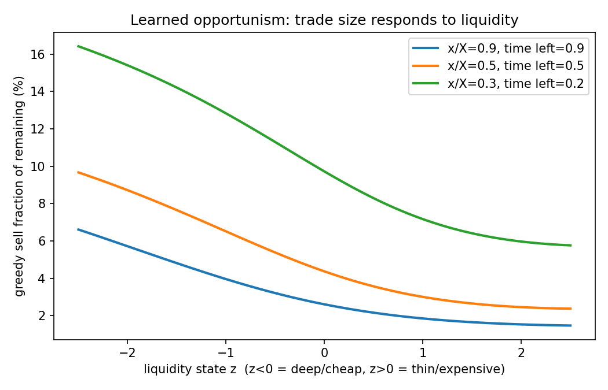
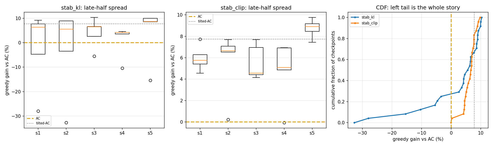
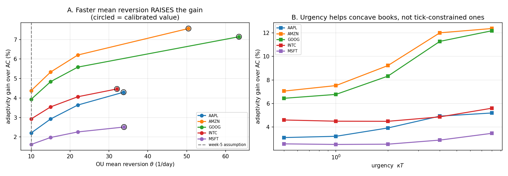

# Reinforcement Learning for Optimal Trade Execution

PPO against the Almgren–Chriss closed-form optimum: verified where an analytical
answer exists, calibrated to NASDAQ limit-order-book data, then pushed into three
regimes where no closed form exists and the gap is measured in dollars.

**Full technical report: [`docs/report_weeks1-7.pdf`](docs/report_weeks1-7.pdf)**
(also as [Markdown](docs/report_weeks1-7.md))

---

## What this is

The hardest question in applied RL is "is my agent actually any good?". This
project removes that question for part of the parameter space by anchoring every
experiment to a problem with a known answer.

Almgren–Chriss (2000) solves optimal execution in closed form: selling `X` shares
over `N` intervals under linear market impact and price risk, the optimal
inventory path is `x(t) = X·sinh(κ(T−t))/sinh(κT)`. So an agent trained in an
environment matching those assumptions must recover that trajectory — any gap is
a bug, not a result. Once the pipeline is verified that way, each assumption is
broken in a direction real markets actually behave, the closed form dies, and the
learned policy is measured against the best baseline that still exists.

Every stage follows the same discipline: **validate the measuring instrument
against a known answer before trusting it on unknown data.** That caught five
calibration bugs, four RL failure modes, and two defects in the evaluation
apparatus itself — all of which produced plausible, stable, wrong numbers.

---

## Headline results

| | result |
|---|---|
| **Recovery of the analytical optimum** | PPO reaches **+0.203%** of `J_AC`, max holdings deviation **2.14%** of order size |
| **Objective ablation** (3 seeds, closed-form scoring) | adaptive KL +0.219% · clip +0.762% · no-clip +20.874% |
| **Adaptivity where liquidity mean-reverts** | median **+6.65%** over the provably optimal open-loop schedule, 25/25 late checkpoints ≥ AC |
| **Impact exponent cross-section** | **0.81** tick-constrained (INTC, MSFT) vs **0.54** high-priced (AMZN, GOOG) — corr(price, exponent) = −0.774 |
| **Calibrated adaptivity gain** | tilted-AC lower bound rises **3.01% → 5.20%** under real mean-reversion rates |
| **RL on calibrated environments** | beats AC by 12.8–18.8% on concave books, **0 blow-ups in 60 checkpoints**; decomposed, **~2.4–5.7%** is genuine adaptivity |



*The behaviour no fixed schedule can produce: the greedy policy sells more when
liquidity is deep (z < 0), shifts its whole response upward as the deadline
approaches, and steepens under time pressure.*

---

## Repository contents

All Python modules sit at the repository root so their flat imports work
unchanged; documentation and generated data live in subfolders. Run everything
from the repository root.

### Stage 1 — environment and analytical anchor (weeks 1–3)

| file | what it does |
|---|---|
| `execution_env.py` | The core environment. Gym-style `ExecutionEnv` with Almgren–Chriss price dynamics (arithmetic random walk, linear permanent + temporary impact), structural terminal liquidation, and closed forms `expected_cost()` / `cost_variance()` for any deterministic schedule. Variant hook methods (`_temp_impact_per_share`, `_post_trade_update`, `_extra_obs`) let later stages override behaviour surgically. |
| `baselines.py` | TWAP schedule, the analytical AC `sinh` schedule, a `SchedulePolicy` wrapper and a Monte Carlo `evaluate_policy()` rollout helper. |
| `sanity_check.py` | **7 checks.** Simulated mean/std shortfall against the closed form for TWAP and AC; AC beats TWAP and 200 random perturbations of itself; λ→0 degenerates to TWAP. Exits non-zero on failure. |
| `frontier.py` | Reproduces the AC efficient frontier (E[IS] vs √Var[IS] across risk aversion). |

### Stage 2 — PPO integration (week 4)

| file | what it does |
|---|---|
| `execution_gym.py` | Gymnasium adapter registering `OptimalExecution-v0` and the three variant ids. Sigmoid-squashed `Box(-8, 8)` action space — the week-4 fix for an optimum sitting on a clip boundary. |
| `test_integration.py` | **7 checks.** Replicates the trainer's exact wrapper stack and `SyncVectorEnv` usage torch-free, including a 3,000-episode TWAP run matched against the closed form. |
| `extract_schedule.py` | Loads a trained checkpoint, rolls the greedy policy through a noise-free environment, and overlays the resulting holdings path on the analytical `sinh` curve. |
| `run_execution.sh` | clip/noclip/kl × 3 seeds on the base environment, with the validated flags. |

### Stage 3 — breaking the assumptions (week 5)

| file | what it does |
|---|---|
| `execution_env_variants.py` | Three subclasses, each deleting exactly one property the closed form needs: `StochasticLiquidityEnv` (lognormal-OU impact coefficient — breaks certainty equivalence), `SqrtImpactEnv` (power-law impact — breaks quadratic costs), `VolumePressureEnv` (spread widening with own recent volume — breaks the Markov state). |
| `variant_sanity.py` | **14 checks in 3 tiers.** Tier 1 is bit-exact degeneracy: with its knob zeroed, each variant must produce *identical* rewards and prices to the validated base environment. Tiers 2–3 check each variant's own closed form against Monte Carlo and verify the economic mechanisms. |
| `analyze_variants.py` | Builds the baseline ladder before any training: TWAP, AC, the numerically optimal open-loop schedule (SLSQP), and the tilted-AC adaptive heuristic that sets the bound RL must beat. |
| `evaluate_variant_policy.py` | Scores checkpoints against those baselines with common random numbers; produces the opportunism plot. |
| `checkpoint_trajectory.py` | Non-convergence diagnostic. Scores every periodic checkpoint and separates a stationary wander from a late decline from genuine under-training (Spearman trend test, exploration-std panel, per-seed spread). |
| `stability_compare.py` | Controlled objective-mode experiment reporting median/IQR/blow-up frequency and the approx-KL tail — the distribution is left-skewed, so the mean is the wrong summary. |
| `run_variants.sh` | The variant training grid. |

### Stage 4 — calibration to real data (week 6)

| file | what it does |
|---|---|
| `lobster_io.py` | LOBSTER message/order-book parsing into natural units, ladder access, clock-time resampling, and the aggressor-sign convention (for an execution, `direction` is the side of the *resting* order, so signed flow is `−direction × size`). |
| `calibrate.py` | All estimators: σ from midprice returns, ε as the time-weighted half-spread, η **and the impact exponent** by walking the bid ladder, γ by Kyle-style flow regression (reported with a standard error and an explicit `NOT IDENTIFIED` flag), and OU liquidity parameters from an AR(1) on log η. Also `eta_from_square_root_law()`. |
| `test_calibration.py` | **26 checks** against synthetic books with known ground truth, including deliberate regression guards for the probe-size, fill-rate and trade-sign bugs listed below. |
| `calibrate_all.py` | Cross-sectional runner: auto-discovers ticker-day file pairs, calibrates each, and prints the comparison table plus per-ticker `ACParams` blocks. |
| `validity_panel.py` | Asks whether the fitted parameters actually apply to the order being executed: extrapolation factor against the largest fitted probe, two-sided economic plausibility of γ, AC feasibility (`η̃ = η − γτ/2 > 0`), and the risk aversion needed for a non-degenerate schedule. |

### Stage 5 — calibrated re-analysis and RL (week 7)

| file | what it does |
|---|---|
| `calibrated_env.py` | One environment combining power-law impact **and** OU liquidity, configured from a calibration table. Impact exponent comes from the book-walk fit; impact *level* from the square-root law. `build_from_calibration()` produces per-ticker configs, optionally solving λ for a target urgency κT. |
| `test_calibrated_env.py` | **16 checks**, including bit-exact degeneracy to all three week-5 variants and a regression test for the per-episode RNG bug. |
| `calibrated_gym.py` | Registers one env id per (ticker, urgency), e.g. `OE-AMZN-kT4-v0`. Each uses `reward_scale = 1/J_AC` computed in closed form, so **AC scores exactly −1.000 in every environment** — the critic sees O(1) targets and a training log is readable without a lookup table. |
| `test_calibrated_gym.py` | **9 checks** that the gym layer does not alter the problem, including a z-test that AC really does score −1 in all 20 environments. |
| `week7_analysis.py` | The two calibrated experiments: the θ ablation and the urgency sweep, measured with the tilted-AC heuristic. |
| `evaluate_calibrated.py` | Scores RL checkpoints as median-over-late-checkpoints against four references, and **decomposes** the gain into misspecification correction (available to a blind open-loop schedule) versus genuine adaptivity. |
| `run_calibrated.sh` | The week-7 training grid with the settings the project established. |

### Vendored, documentation and data

| path | notes |
|---|---|
| `ppo_continuous.py` | The PPO trainer, from the author's CS5180 capstone reproduction of Schulman et al. (2017). Vendored because the environments train on it directly. Two modifications, both documented in its header and in the report: the normaliser gate and periodic checkpointing. |
| `plot_results.py` | Learning-curve and ablation plotting, from the same capstone. Unmodified. |
| `docs/report_weeks1-7.md/.pdf` | The full technical report (9 pages). |
| `docs/figures/` | Figures referenced by the report and this README. |
| `data/calibration_lobster_2012-06-21.csv` | Fitted parameters for the five LOBSTER sample tickers. **Derived estimates only** — no raw order-book rows are redistributed. Copy to `calibration_all.csv` to run stage 5 without downloading data. |
| `data/opt_schedule_*.npy` | Numerically optimal open-loop schedules, regenerated by `analyze_variants.py`. |

---

## Setup

```bash
pip install -r requirements.txt
```

The analysis, calibration and environment code needs only NumPy, pandas, SciPy,
matplotlib and Gymnasium. PyTorch is needed only to train or score policies.

## Reproducing the results

**Verify first.** Every harness below is fast and torch-free. All five pass on a
clean checkout — **70 assertions** in total — and nothing downstream should be
trusted until they do.

```bash
python sanity_check.py          # 7  — environment vs Almgren-Chriss closed form
python variant_sanity.py        # 14 — variants, incl. bit-exact degeneracy
python test_integration.py      # 7  — gym wrapper stack
python test_calibration.py      # 26 — estimators vs synthetic ground truth
python test_calibrated_env.py   # 16 — calibrated environment
```

**Stage 2 — recover the analytical optimum.**

```bash
python ppo_continuous.py --env-id "execution_gym:OptimalExecution-v0" \
    --mode clip --seed 1 --gamma 1.0 --no-clip-vloss --total-timesteps 1000000
python extract_schedule.py      # greedy schedule, overlay plot, closed-form gap
bash run_execution.sh           # full clip/noclip/kl ablation
```

**Stage 3 — the variants.**

```bash
python analyze_variants.py      # baseline ladder and the bounds to beat
bash run_variants.sh
python evaluate_variant_policy.py
```

**Stage 4 — calibration.** Needs the free LOBSTER samples
(<https://lobsterdata.com/info/DataSamples.php> — AAPL, AMZN, GOOG, INTC, MSFT,
2012-06-21, level 10). Unzip them into one directory, then:

```bash
python calibrate_all.py --dir /path/to/lobster
python validity_panel.py --pct-adv 1.0
```

**Stage 5 — calibrated analysis and RL.** To skip the download, use the shipped
derived parameters:

```bash
cp data/calibration_lobster_2012-06-21.csv calibration_all.csv
python calibrated_gym.py        # list the 20 registered environments
python test_calibrated_gym.py   # 9 checks (needs calibration_all.csv)
python week7_analysis.py --n-episodes 8000
bash run_calibrated.sh
python evaluate_calibrated.py
```

---

## What the report contains

[`docs/report_weeks1-7.pdf`](docs/report_weeks1-7.pdf) — 8 pages, 10 sections, 4 figures.

**§2–3 Theory and environment.** Implementation shortfall; the separate roles of
permanent impact (punishing *how much* you sell) and temporary impact (punishing
*how fast*); the derivation of `E[IS]` and `Var[IS]`; why the Euler–Lagrange
equation `ẍ = κ²x` yields the `sinh` trajectory; and how the reward is built as
an exact per-step decomposition of the objective so that maximising return is
provably equivalent to solving Almgren–Chriss.

**§4–5 The correctness experiment, and four failure modes.** PPO recovers the
analytical optimum to +0.203%. Getting there surfaced four failures, each
invisible in standard training diagnostics:

1. **Categorical policy collapse.** Plateaued +114% above optimum. Gradients were
   correct to 1e-10; the probe that resolved it showed `Q(s₀, 6%) > Q(s₀, 10%)`
   while `P(10%|s₀) = 1.000`. A categorical head destroys the ordinal structure
   of the action space, so the policy cannot slide toward a smooth optimum.
2. **Self-inflicted distribution shift.** Noise-free training as a variance
   reduction converged to +0.02% and then scored +112% honestly: the agent had
   learned to use the deterministic price path as a time proxy.
3. **Reward normalisation destroying a heavy-tailed signal.** Explained variance
   0.96, value loss → 0, and a policy 20× worse than TWAP. MuJoCo's normalisers
   divide by a std dominated by cost spikes, erasing the routine differences that
   *are* the problem.
4. **Value-loss clipping and the action boundary.** The optimal early action sits
   against a `[0,1]` clip boundary, where half of a Gaussian's samples collapse to
   one identical action.

The objective ablation (closed-form greedy scoring) puts adaptive KL ahead of
clipping on every seed — replicating, on a new problem class, an anomaly from the
author's MuJoCo reproduction.

**§6 Breaking the assumptions.** Three variants, each deleting one property, with
bit-exact degeneracy to the validated base environment. Results separate on a
single axis — whether the broken assumption creates *exploitable stochastic
structure*. Where it does, PPO beats the provably optimal open-loop schedule;
where it does not, PPO matches the numerical optimum and nothing more. One
prediction (that volume-pressure spreads would reward pulsed trading) was
falsified before any training: spread pressure penalises clustering, so it rewards
the smoothness AC already has.

§6.6 documents a fifth failure. Late-training performance did not converge — it
passed through +9% and −28% fifty updates apart, with no trend but a 10.15pp
standard deviation. Two hypotheses were eliminated by measurement (exploration std
was healthy; the LR anneal was already enabled). A controlled experiment isolated
the cause: adaptive KL bounds *average* divergence, so single updates pass through
at six times clipping's divergence, which is fatal when the optimum sits beside a
cliff.

| arm | median | IQR | worst | blow-ups | approx-KL p99 |
|---|---:|---:|---:|---:|---:|
| adaptive KL | +5.55% | 12.04 | −32.70% | 20.0% | 0.1200 |
| clipped | **+6.65%** | **2.81** | **−0.06%** | **0.0%** | 0.0195 |



**§7 Calibration.** Estimators validated against synthetic books first, which
caught five defects that would each have been silent on real prices: probe sizes
below top-of-book depth (biasing the exponent to 1.56 on a known-linear book);
the walk-curve intercept being `ε − tick/2` rather than `ε` (biasing η down 32%);
probes exceeding displayed depth filling only on deep books (collapsing the
exponent to 0.000); a regression off-by-one (γ = −1.23e−06 where truth was
+2.5e−05); and a hardcoded OU probe size inside a deep book's top level (log-std
13.09 against a true 0.30).

The cross-sectional finding: the fitted impact exponent falls with price level,
so the linear AC model is defensible for tick-constrained names and misspecified
for high-priced ones. §7.4 then traces three validity failures — extrapolation,
implausible γ, and AC infeasibility — to a single cause: the book-walk estimate of
η is **37–293× below** the square-root law, because walking the displayed book
prices an immediate sweep rather than an order worked over hours.

**§8 The calibrated re-analysis.** Both standing predictions were falsified.
Faster mean reversion was expected to erode adaptivity; it *raises* it by 56%,
because a highly persistent liquidity state is nearly constant within an episode,
and a constant state cannot be exploited by reallocating volume. Urgency was
expected not to help; it roughly doubles the gain for concave-book names while
leaving tick-constrained ones flat — and the `α*` column shows why, since
concentrating volume costs `n^(1+p)` and only a concave book makes that affordable.



§8.4 records that the measuring instrument was itself clipping the result: 900
episodes masked a real monotone trend, and the tilt grid stopped exactly where the
concave-book optima sat.

**§9–10 Inventory, limitations and next steps.**

---

## Honest limitations

- **The headline RL number decomposes.** On calibrated environments PPO beats AC
  by 12.8–18.8%, but a blind open-loop schedule using no liquidity information
  captures 7.5–15.4% of that simply by fixing AC's misspecified *shape* under
  concave impact. Genuine adaptivity is **~2.4–5.7%** — consistent and real, but
  much more modest than the raw figure. `evaluate_calibrated.py` reports both.
- **γ is not identified** from a single ticker-day: price noise swamps the impact
  signal (R² ≈ 0.002), and the contemporaneous flow regression is biased upward by
  simultaneity. Treat it as a sensitivity axis, not an estimate.
- **The calibration is one trading day, five tickers.** The exponent cross-section
  is indicative, not a test; the confidence intervals overlap and n = 5.
- **Fills are modelled, not queued.** The environment prices impact through a cost
  function rather than simulating queue position.
- **Synthetic validation cannot catch every bias.** It missed the simultaneity bias
  in γ precisely because the generator draws trade signs exogenously — which is why
  `validity_panel.py` exists alongside `test_calibration.py`.

---

## References

- Almgren & Chriss (2000), *Optimal Execution of Portfolio Transactions*, J. Risk 3(2)
- Schulman et al. (2017), *Proximal Policy Optimization Algorithms*, arXiv:1707.06347
- Cartea, Jaimungal & Penalva (2015), *Algorithmic and High-Frequency Trading*, ch. 6
- Almgren (2003), *Optimal execution with nonlinear impact functions*
- LOBSTER limit-order-book data: <https://lobsterdata.com>

## License

MIT — see [`LICENSE`](LICENSE).
