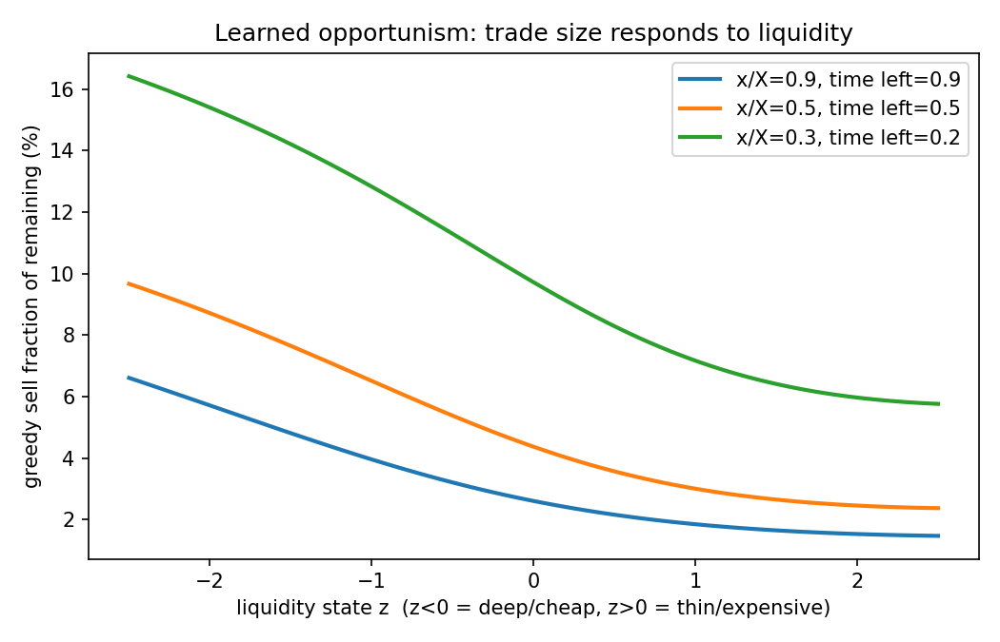

# Reinforcement Learning for Optimal Trade Execution: Weeks 1–7 Technical Report

**Project:** PPO vs. Almgren-Chriss for optimal execution · **Author:** Benji · **Period:** July 6 – present · **Status:** Weeks 1–7 analysis complete; RL runs on calibrated environments outstanding

---

## 1. Summary

This project trains reinforcement-learning agents to execute a large sell order over a fixed horizon and benchmarks them against the closed-form optimal schedule of Almgren and Chriss (2000). The central methodological idea is that the analytical solution turns a notoriously vibes-based question — "did my RL agent learn something good?" — into a falsifiable one: under the model's assumptions, the provably optimal policy is known, so the agent either recovers it or it doesn't, and the gap is measurable in dollars.

As of the week-4 milestone, a PPO implementation originally written for a MuJoCo paper reproduction (CS5180 capstone) trains on the execution environment with zero code changes to the training script and converges to within **+0.203% of the analytical optimum** in mean-variance objective, with a maximum holdings-trajectory deviation of **2.14% of the order size** from the theoretical sinh curve. Reaching that result surfaced and resolved four distinct, diagnosable failure modes — a categorical-policy collapse, a self-inflicted distribution shift, reward-normalization destruction of the learning signal, and two interacting boundary/clipping pathologies — each of which was invisible in standard training diagnostics and caught only by comparison against closed-form ground truth. A three-way objective ablation (clipped surrogate vs. no clipping vs. adaptive KL penalty) was then run across three seeds each, extending the capstone's MuJoCo ablation to a financial control problem and replicating its two headline findings on a new domain.

Week 5 then removes the answer key. Three environment variants each break exactly one assumption the Almgren-Chriss derivation depends on, and the learned policy is measured against the best schedule available under the true dynamics rather than against the formula. The results separate cleanly along a single axis — whether the broken assumption creates *exploitable stochastic structure*. Where it does (mean-reverting liquidity), PPO beats the provably-optimal open-loop schedule by a median of 6.65% with every one of 25 late checkpoints at or above it; where it does not (nonlinear impact, volume-pressure spread), PPO matches the numerical optimum and nothing more. Reaching that statement required diagnosing a non-convergence that the standard training diagnostics did not show, and a controlled experiment traced it to the objective mode: the adaptive-KL penalty bounds average divergence rather than per-sample ratios, and permits occasional catastrophic updates on an objective whose optimum sits beside a cliff.

Weeks 6 and 7 replace the assumed parameters with estimates from real limit-order-book data. Calibration against the LOBSTER samples yields a cross-sectional finding — the impact exponent falls systematically with price level, so the linear Almgren-Chriss model is defensible for tick-constrained names and mis-specified for high-priced ones — and, less comfortably, five estimator bugs that only synthetic ground truth could have exposed. Re-running the week-5 comparison under calibrated parameters then falsified both of this report's standing predictions. Faster liquidity mean reversion was expected to erode the value of adaptivity; it raises it by 56%, because a highly persistent liquidity state is nearly constant within an episode and a constant state cannot be exploited by reallocating volume. Urgency was expected not to matter, or to matter adversely; it roughly doubles the gain for concave-book names while leaving tick-constrained names flat.

The rest of this report gives the theory, the environment design and its validation, the experimental record including all five post-mortems, the integration with the existing PPO stack, the week-5 variant program, the week-6 calibration, the week-7 calibrated re-analysis, and what remains.

## 2. Problem and theory

### 2.1 Implementation shortfall

A trader must sell X shares over a horizon T divided into N intervals of length τ. At the decision time the price is S₀, so the paper value of the position is X·S₀. Because the order is executed gradually at prices S̃ₖ, the realized proceeds fall short of paper value by the implementation shortfall, IS = X·S₀ − Σₖ nₖ·S̃ₖ, where nₖ is the quantity sold in interval k. IS is a random variable: waiting exposes the trader to price risk, while trading quickly incurs market impact. Almgren-Chriss (AC) resolves the tension by minimizing the mean-variance objective J = E[IS] + λ·Var[IS], with λ a risk-aversion parameter.

### 2.2 Price dynamics and impact

The model has two impact channels with cleanly separated roles. The price follows an arithmetic random walk with **permanent impact**: Sₖ = Sₖ₋₁ + σ√τ·ξₖ − γ·nₖ. Selling depresses the price by γ·nₖ and the depression persists, so every later trade executes in a world made cheaper by every earlier one. Execution itself occurs at a **temporarily** impacted price S̃ₖ = Sₖ₋₁ − (ε·sign(nₖ) + (η/τ)·nₖ): a fixed half-spread cost ε per share plus a penalty on the trading *rate* nₖ/τ, reflecting how fast trading walks deeper into the order book, which refills before the next interval. Permanent impact γ punishes how much is sold in total; temporary impact η punishes how fast.

### 2.3 Closed forms

Substituting the recursion into IS and taking expectations, the noise vanishes and the permanent-impact cross-term telescopes (Σⱼ₍ₖ nⱼnₖ = ½(X² − Σnₖ²)), giving

E[IS] = ½γX² + εX + (η̃/τ)·Σₖ nₖ²,  with η̃ = η − ½γτ.

The first two terms are schedule-independent: selling X shares costs the full spread and half the permanent impact no matter what. Only the Σnₖ² term is controllable, and it is minimized by equal trades — pure cost minimization implies TWAP. The variance comes entirely from the shocks: shock j hits the xⱼ shares still held at that moment, so

Var[IS] = σ²τ·Σₖ xₖ².

Risk at each instant is remaining inventory squared, so pure variance minimization implies immediate liquidation. The whole problem is the tension between these two pulls.

### 2.4 The optimal schedule

Minimizing J in the continuous limit is a calculus-of-variations problem formally identical to a classical-mechanics Lagrangian, ∫(η̃ẋ² + λσ²x²)dt, whose Euler-Lagrange equation ẍ = κ²x with κ² = λσ²/η̃ yields

x(t) = X · sinh(κ(T − t)) / sinh(κT).

κ is an urgency parameter (units 1/time): it rises with risk aversion and volatility and falls with temporary impact. As λ→0 the schedule degenerates to TWAP; as λ→∞ it approaches immediate liquidation. The implementation uses the exact discrete-time version, with κ obtained from cosh(κτ) = 1 + ½κ̃²τ² where κ̃² = λσ²/η̃.

### 2.5 Parameters

All experiments use the worked-example parameters of the AC paper, scaled to a one-day horizon: X = 1,000,000 shares, S₀ = $50, T = 1 day, N = 50 intervals, σ = $0.95/day, γ = 2.5×10⁻⁷, η = 2.5×10⁻⁶, ε = $0.0625, λ = 2×10⁻⁶. Under these parameters the analytical references are:

| schedule | E[IS] | √Var[IS] | J = E + λ·Var |
|---|---:|---:|---:|
| AC optimal | $2,710,378 | $515,386 | **$3,241,623** |
| TWAP | $2,685,000 | $540,249 | $3,268,737 |

Note the instructive inversion: AC has *higher* expected cost than TWAP but lower variance — the risk-averse trader deliberately front-loads selling, paying extra impact to shed exposure faster. J_AC and J_TWAP differ by only 0.84%, which sets the precision bar for everything downstream.

## 3. Environment and validation (weeks 1–3 scope)

### 3.1 Design

`execution_env.py` implements a gym-style environment. The observation is three-dimensional: remaining inventory fraction, remaining time fraction, and price change since arrival normalized by σ√T. The action is the fraction of *remaining* inventory to sell this interval (discrete grid or continuous mode). The final step force-liquidates whatever remains, so the constraint Σnₖ = X holds structurally rather than through a penalty — this eliminates an entire class of reward hacking (holding inventory past the horizon) by construction. The per-step reward is the negative shortfall increment minus the risk penalty λσ²τxₖ², scaled by 10⁻⁶ so episode returns are O(3). The reward telescopes exactly: the episodic return equals −(IS + λ·risk term), so in expectation the return-maximizing policy is precisely the AC schedule. This identity is what makes the week-4 experiment a correctness test rather than a benchmark.

The environment also exposes the closed forms `expected_cost(schedule)` and `cost_variance(schedule)` for any deterministic trade list, which later became the project's most valuable diagnostic instrument: any deterministic policy can be scored *exactly*, with zero Monte Carlo noise, by extracting its schedule and evaluating the formulas.

### 3.2 Validation

`sanity_check.py` runs seven checks over 20,000 episodes and exits nonzero on failure (CI-compatible). Simulated mean shortfall matches theory within 1.7 standard errors for both TWAP and AC; simulated standard deviations match to three decimal places of relative error; the AC schedule beats TWAP on J and beats all 200 random total-shares-preserving perturbations of itself; and the λ→0 limit recovers TWAP to 1.2×10⁻⁷ relative deviation. `frontier.py` reproduces the AC efficient frontier (E[IS] vs. √Var[IS] under a λ sweep), with TWAP sitting at the minimum-cost/maximum-variance endpoint as theory requires. These checks pinned the simulator to the model before any learning was attempted, which proved essential: every subsequent RL failure could be attributed to the *agent* with confidence, because the environment's correctness was already established.

## 4. Week 4: the correctness experiment and four failure modes

The week-4 experiment asks: does PPO, trained in the environment whose assumptions match AC exactly, recover the AC schedule? A first implementation was built in pure NumPy (manual backprop, verified against finite differences to ~10⁻¹⁰ relative error) after the sandbox could not host PyTorch; this turned out to be an asset, since every gradient was independently checkable. The final result was then reproduced on the original torch PPO stack. Four failures occurred en route; all four are documented here deliberately, because each is a reusable lesson and none was visible in conventional training metrics.

### 4.1 Failure 1: categorical policy collapse

The first agent used a categorical policy over 51 discretized fractions of remaining inventory {0%, 2%, …, 100%}. It improved rapidly from the uniform initialization (J ≈ 41M) and then plateaued at J ≈ 6.92M, +114% above the optimum — stalling at a policy that sells a constant 10% of remaining inventory every step. Diagnostics excluded a gradient bug (numerical checks passed at 10⁻¹⁰) and excluded reward noise (retraining with a noise-free price path stalled at the identical J). A landscape scan showed constant-fraction policies at 4%, 6%, and 8% all dominate 10% by margins of 1.3M+ in J, so even a myopic improvement direction existed.

The probe that resolved it: empirical Q-values at the initial state gave Q(s₀, 6%) = −6.623 > Q(s₀, 8%) = −6.721 > Q(s₀, 10%) = −6.924 — a decisive ordering — while the policy assigned P(10% | s₀) = 1.000. The softmax had saturated early, when gradients from the catastrophic initial region were enormous, and policy gradient cannot learn from actions it never samples: a provably better *neighboring* action received zero signal. The reported training entropy (~1.4 nats) was misleading, concentrated at late timesteps where inventory is nearly zero and actions are inconsequential. A strong entropy schedule (coefficient 0.05 held for 400 updates) mitigated but did not fix the problem (plateau at 5.6M, +73%).

The structural diagnosis is the transferable lesson: a categorical head over discretized actions destroys the *ordinal* structure of the action space. The agent has no representation of the fact that 8% is adjacent to 10%, so it cannot slide locally toward an optimum that is a smooth function of state — and the AC optimum is exactly that, a fraction-of-remaining sweeping smoothly from ~2.4% at the open to 100% at the close. The fix was a Gaussian policy over the continuous fraction (state-dependent mean, single learned log-std), which restores a metric on actions and makes exploration local. This is also precisely the parameterization used by standard continuous-control PPO implementations, including the capstone's.

### 4.2 Failure 2: self-inflicted distribution shift

The Gaussian agent was first trained with the price noise switched off, as a variance-reduction device. The justification is exact as far as it goes: under base AC dynamics the noise is zero-mean and unaffected by any state-feedback policy, so the expected return of any *fixed* policy is identical with noise on or off, and the variance term enters the reward through the deterministic risk penalty rather than realized noise. Training converged beautifully — within +0.02% of J_AC on the closed-form score, with the greedy holdings path overlaying the sinh curve to 0.37% of X.

The honest evaluation in the noisy environment then returned J = 6.87M, +112%. The optimizer had exploited the trick: with noise off, the price-change observation follows a deterministic path and is therefore a perfect proxy for time; the network learned to condition on it, and under real noise the proxy scrambles. Variance reduction preserved the objective but changed the *state distribution*, and the policy overfit to the training manifold. The lesson generalizes well beyond this project: an intervention that provably preserves expected returns can still change what features are informative, and the optimizer will find whatever is informative. Retraining with noise on — now unproblematic, since the parameterization was fixed — converged to within +0.14% to +0.6% of J_AC across the training tail, with the exploration std annealing autonomously from 1.0 to 0.044.

### 4.3 Integration with the capstone PPO stack

With the NumPy pipeline validated, the environment was connected to the CS5180 PPO reproduction (`ppo_continuous.py`: torch, Gaussian policy, GAE, the paper's three objective modes, CSV/TensorBoard logging, seed-averaged plotting). The bridge is a single adapter, `execution_gym.py`, which wraps the environment in the Gymnasium API and registers it as `OptimalExecution-v0`; Gymnasium's module-prefix env-id syntax (`--env-id "execution_gym:OptimalExecution-v0"`) triggers the registration import at `gym.make` time, so the training script, run scripts, CSV schema, and plotting pipeline required no modification. A torch-free integration test (`test_integration.py`, seven checks) replicates the training script's exact six-wrapper stack and SyncVectorEnv usage, verifies episode statistics surface in the form the logger consumes, and drives a TWAP policy through the gym pathway for 3,000 episodes, matching the closed-form cost at z = 0.15.

Because `RecordEpisodeStatistics` wraps inside the reward normalizers, the logged episodic return is the raw scaled return −(IS + λ·risk) in $ millions, so every learning curve has an exact analytical target: −3.2416 (AC), with TWAP at −3.2687.

### 4.4 Failure 3: reward normalization destroys a heavy-tailed signal

The first torch run produced a log that looked exemplary — explained variance 0.96, value loss →0, approx-KL stable in the 0.001–0.008 band, no instability — and a policy at episodic return **−66**, twenty times worse than TWAP. The disconnect is the diagnosis: all console metrics are computed on the *training* signal, and the MuJoCo-default wrapper stack transforms that signal through `NormalizeObservation`, `NormalizeReward`, and clips at ±10 before the agent sees it. MuJoCo rewards are dense and homogeneous in scale; execution rewards are heavy-tailed, with routine steps costing ~0.05–0.1 units and large sells or the forced terminal liquidation producing spikes tens to hundreds of times larger. The running normalization divides by a std dominated by spikes, scaling the routine differences — which encode the entire content of the AC problem — toward numerical dust, while the clip flattens all large mistakes to the same value. What survives is the coarse lesson "avoid catastrophic dumps," which is what a −66 policy is. The critic learned this distorted signal perfectly, hence the excellent explained variance. The fix gates the four normalization wrappers off for this environment (the observations are already well-scaled by construction), keeping `RecordEpisodeStatistics` and `ClipAction`. The broken 9-run grid was retained as `runs_broken_normalizers/` — it is the "normalizers on" arm of a one-line ablation demonstrating the failure.

### 4.5 Failure 4: value-loss clipping and the action boundary

With normalizers off, performance improved to −24 and plateaued. Two further MuJoCo defaults were implicated, visible in the same log. First, value-loss clipping (±0.2 per update around the previous prediction) throttled a critic whose raw targets start around −80: value loss remained in the hundreds through mid-training and explained variance crawled rather than snapped upward, and a lagging critic yields poor advantages. The script's existing `--no-clip-vloss` flag resolves it. Second, and more structural: the clip-in-env action pattern maps every Gaussian sample below zero to "sell nothing," making the entire left half of action space flat — harmless on MuJoCo, where optima are interior, but the AC optimum's early-day action (~0.024) sits directly against that boundary, forcing the policy mean to hover where half its samples collapse to one identical action with degenerate gradient information. The environment-side fix replaces the clip with a **sigmoid squash**: the action space becomes Box(−8, 8) and the env applies σ(u), relocating the optimum to an ordinary interior point (u ≈ −3.7). This mirrors the parameterization the NumPy implementation had used from the start.

With both fixes (`--gamma 1.0 --no-clip-vloss`, sigmoid squash, 1M steps), the torch run converged: value loss below 0.15 by update 30, explained variance 0.93 almost immediately, and a last-100-episode stochastic return of **−3.2648** — past TWAP and within 0.7% of the optimum with exploration noise still included.

## 5. Week-4 results

### 5.1 Milestone: recovery of the analytical optimum

Greedy-schedule extraction (`extract_schedule.py`: greedy mean action, noise-free rollout, closed-form scoring) from a converged checkpoint gives:

| quantity | value |
|---|---:|
| J(PPO greedy) | $3,248,210 |
| J(AC optimal) | $3,241,623 |
| **gap** | **+0.203%** |
| J(TWAP) | $3,268,737 |
| max holdings deviation from sinh curve | 2.14% of X |

The week-4 exit criterion — a PPO policy whose execution trajectory overlays the analytical AC curve within noise — is met, on the same torch implementation that reproduced Schulman et al. on MuJoCo. (The quoted checkpoint is adaptive-KL, seed 3; the complete per-mode, per-seed greedy scoring follows in 5.2.)

### 5.2 Objective ablation on the execution environment

The full grid (clip / noclip / kl × seeds 1–3, 1M steps each) reuses the capstone's ablation machinery unchanged. Every checkpoint was scored on the greedy closed-form objective — extract the deterministic greedy schedule, evaluate J exactly — which removes all Monte Carlo noise from the comparison:

| mode | seed 1 | seed 2 | seed 3 | mean gap to J_AC |
|---|---:|---:|---:|---:|
| clip | +0.446% | +1.089% | +0.752% | +0.762% (± 0.263) |
| kl | +0.215% | +0.239% | +0.203% | **+0.219% (± 0.015)** |
| noclip | +30.409% | +4.623% | +27.589% | +20.874% (± 11.548) |

Three observations. First, adaptive KL is not merely comparable to clipping here — it is better on every seed with no overlap (worst KL seed +0.239% vs. best clip seed +0.446%; under a rank test, all-three-beat-all-three has one-sided p = 0.05 even at n = 3) and roughly seventeen times more consistent (± 0.015 vs. ± 0.263). In dollar terms, mean excess execution cost per 1M-share order is about $7,100 for KL, $24,700 for clip, and $677,000 for no-clip. Second, every no-clip seed — including its lucky one at +4.6% — is worse than naive TWAP (+0.836%): the unstabilized agent underperforms the dumbest baseline after a million training steps, while its ±11.5% seed spread is the signature of an unstabilized method rather than a uniformly bad one. Third, the stochastic-return bars showed clip and KL as indistinguishable; only the closed-form greedy scoring resolved the half-point separation between them, because each mode's exploration noise (annealed differently) pollutes stochastic returns. This is the zero-noise metric of section 5.3 earning its keep on the project's own headline comparison.

Two cross-domain observations against the capstone's MuJoCo results. First, the paper's main claim — clipping matters — replicates, but with a different failure texture: on MuJoCo, no-clip *diverged* (e.g., 258 vs. 5609 on InvertedDoublePendulum), whereas here it merely underperforms with high seed variance. A plausible mechanism is that this environment is short-horizon, low-dimensional, and quadratic-ish, so oversized policy updates land somewhere recoverable, while a destroyed locomotion gait removes the very return signal needed to rebuild it; trust regions matter most on unforgiving landscapes. Second, the capstone's anomalous finding that adaptive KL matches or beats clipping — contrary to the paper's emphasis — replicates on a completely different problem class, upgrading it from possible noise to a consistent two-domain observation.

### 5.3 Methodological findings

Four practices earned their keep and are worth stating as findings in their own right. Validating the simulator against closed forms *before* training localized every later failure to the agent. Scoring deterministic policies with the closed-form J (rather than Monte Carlo returns) gave a zero-noise convergence metric able to resolve gaps of 0.1% that episodic returns cannot. Numerical gradient checking cleanly separated "the math is wrong" from "the learning dynamics are wrong," which are otherwise easy to conflate. And the post-mortems share a common structure: in every case the standard diagnostics looked healthy while the policy was bad, and only the analytical reference exposed the problem. On real market data, where no such reference exists, all of them would likely have shipped. §6.6 adds a fifth instance and one further practice — evaluating *repeatedly across training* rather than once at the end, since a single final-checkpoint score is a sample from whatever distribution the late-training dynamics produce, and in one environment here that distribution spanned 37 percentage points.

Weeks 6 and 7 extend the pattern from models to measurements. Five calibration estimators were wrong in ways that produced plausible numbers rather than visible failures (§7.2), and were caught only because synthetic data supplied a known answer. Two further defects sat in the measuring apparatus itself: a Monte Carlo sample too small to resolve a real trend, and a parameter grid that clipped the optimum it was searching for (§8.4). The general lesson the project keeps rediscovering is that a number being stable, plausible and reproducible is not evidence that it is right; only comparison against something independently known has ever caught these. Every quantitative claim in week 7 moved at least once under that scrutiny, and both of the report's standing predictions were falsified by it.

## 6. Week 5: breaking the Almgren-Chriss assumptions

### 6.1 Design: which assumption each variant removes

The AC closed form rests on three properties, and the variants were designed to delete exactly one each. **P1 — quadratic costs with constant coefficients**, which makes the objective ∫(η̃ẋ² + λσ²x²)dt and the Euler-Lagrange equation the linear ODE ẍ = κ²x. **P2 — certainty equivalence**: the only randomness is a zero-mean price martingale that neither predicts future costs nor responds to trade timing, so the optimal adaptive policy collapses to a deterministic schedule. **P3 — an (inventory, time) Markov state**, so the Lagrangian is pointwise in time.

`StochasticLiquidityEnv` (breaks P2) lets the temporary-impact coefficient follow a lognormal Ornstein-Uhlenbeck process with per-interval autocorrelation ρ = exp(−θτ), calibrated so E[η_t] = η exactly. The agent observes the standardized log-liquidity state; AC does not. `SqrtImpactEnv` (breaks P1) replaces linear temporary impact with a power law, with the coefficient calibrated so per-share impact matches the linear model at the TWAP trading rate — so the comparison isolates the change in *curvature*, not a change in overall cost level. `VolumePressureEnv` (breaks P3) makes the spread widen with recent own-volume, ε_k = ε(1 + βP_k) with P decaying geometrically, so trading now raises the near-future cost of trading and (x, t) is no longer Markov.

Each variant is a subclass overriding only three hook methods, so the reward identity (return = −(IS + λ·risk)) and the structural terminal liquidation are inherited untouched from the validated base environment.

### 6.2 Validation: exact degeneracy

`variant_sanity.py` runs three tiers. Tier 1 is the strongest check available: with its knob zeroed, each variant must produce **bit-identical** rewards and prices to the base environment under the same seed and action sequence. All three do, at max |Δr| = 0.000e+00 — possible because variant-specific randomness is drawn from a separate generator, leaving the price-noise stream untouched. Tier 2 validates each variant's own closed form against Monte Carlo (z = 0.99 for sqrt, 1.13 for pressure), and confirms the liquidity calibration: because E[η_t] = η, every deterministic schedule has the same expected cost as in the base environment (z = 0.57). Tier 3 checks mechanisms — deep liquidity is cheaper than thin ($1.33 vs $4.27 per share at ±1.5σ), the sqrt calibration point is exact, and bursty schedules cost more than spaced ones under volume pressure.

### 6.3 Baselines and pre-registered predictions

`analyze_variants.py` establishes what RL must beat before any training, which converts the week-5 experiments into falsifiable tests rather than open-ended searches.

For the liquidity variant, the calibration has a strong consequence: since expected temporary cost is linear in η_t, every deterministic schedule costs exactly what it costs in the base environment, so **the AC schedule is provably the optimal open-loop schedule**. Any improvement is therefore a pure measurement of the value of adaptivity, with no confound from schedule mis-specification. A one-parameter adaptive heuristic — tilted-AC, frac_k = ac_frac_k · exp(−α z_k) — was swept to provide a non-trivial floor: α = 0.25 beats AC by **7.75%**, while α = 0.75 and α = 1.5 lose 40% and 1570% respectively. That asymmetry (a sharp optimum beside a cliff) becomes important in §6.6.

For the other two variants the numerical optimum over deterministic schedules was computed directly (SLSQP on the exact expected-cost objective). Under square-root impact, the mis-specified AC schedule sits 0.734% above the true optimum, so the prediction was: RL should *match* the numeric optimum, not beat it, since no exploitable stochastic state exists.

The volume-pressure prediction was **falsified before training**. The prior expectation, stated in the design notes, was that pressure would reward pulsed trading — bursts spaced to let pressure decay — a shape sinh cannot represent. The numerical optimum instead coincides with AC to four significant figures (3,287,716 vs 3,287,702). In hindsight the mechanism is clear: a spread that widens with *own* recent volume penalizes clustering, and therefore rewards exactly the smoothness AC already has. Pulsing belongs to resilience/transient-impact models (Obizhaeva-Wang), where price displacement decays and trading into recovered prices is cheap — a different mechanism. The variant became a robustness finding (AC survives spread memory at this scale) and a third match-target.

### 6.4 Results

Monte Carlo evaluation of greedy policies, 20,000 episodes with common random numbers, against the baselines in each variant's own dynamics:

| variant | assumption broken | adaptivity exploitable? | reference | PPO result |
|---|---|---|---|---|
| Stochastic liquidity | P2 (certainty equivalence) | **yes** | AC = optimal open-loop, J = 3,619,653 | **median +6.65%**, 25/25 late ckpts ≥ AC (clip mode) |
| Square-root impact | P1 (quadratic costs) | no | numeric optimum J = 3,192,976 | 3,192,277 / 3,202,207 / 3,208,303 — matches within MC error |
| Volume pressure | P3 (Markov state) | no | numeric optimum ≡ AC, J = 3,277,112 | −0.946% / +0.383% / −0.927% vs AC |

The sqrt agents land on the numeric optimum (seed 1 marginally below it, within the ≈3.6k standard error), which constitutes a second and harder correctness test than week 4: PPO recovers a *numerically computed* optimum for a nonlinear-impact problem that has no closed form, and all three seeds beat the mis-specified AC schedule.

The pressure result is the most informative negative in the project. The ceiling is AC itself, and the agents land slightly below it — they are not failing to find an edge, there is no edge to find, and the small shortfall is the optimization tax for learning a policy in a four-dimensional state whose optimal policy ignores the fourth dimension. Stated generally: **RL's advantage here is not that it executes better than Almgren-Chriss, but specifically that it captures exploitable stochastic structure when such structure exists.** Break an assumption in a way that creates no adaptive opportunity and RL is at best neutral.

### 6.5 Mechanism: learned opportunism

The liquidity result is supported by a behavioral figure rather than a number alone.

 Plotting the greedy sell fraction against the observed liquidity state z at fixed (inventory, time) slices shows three properties. The response is **monotone decreasing in z** — sell more when liquidity is deep — which is the behavior no open-loop schedule can produce by construction. The whole response function **shifts upward as the deadline approaches** (1.5–6.6% of remaining at x/X = 0.9 with 90% of the day left; 5.8–16.4% at x/X = 0.3 with 20% left), reflecting that inventory must go regardless. And the two interact: the response is **steeper under time pressure**, because a cheap liquidity window is worth most when inventory is still large and time is short.

That interaction is precisely what a one-parameter heuristic cannot express — tilted-AC applies a single responsiveness α at all times — and is the most plausible explanation for why the learned policy is competitive with a bound that was tuned specifically for this environment. The curves also flatten rather than vanishing at high z: the inventory risk charge keeps pressing even when trading is expensive, so the agent modulates the AC trade-off rather than abandoning it. These are slices through a learned function, not a proof of optimality; the optimality evidence is the Monte Carlo J.

### 6.6 Failure 5: non-convergence, and the cost of final-checkpoint evaluation

The liquidity numbers above are stated as medians over late checkpoints for a reason. Initial results scored only the final weights of each run and gave +10.08%, +8.53%, +3.37% at 1M steps. Rerunning the low seed at 2M steps raised it to +8.88%, suggesting underfitting — but rerunning *all* seeds at 2M made two of the three **worse** (+4.25%, +7.72%), and the mean fell. More budget was not the answer, and the underfitting reading was wrong.

Periodic checkpointing (every 50 updates) across five seeds settled it. Late-half performance showed no trend (mean Spearman ρ = +0.04) but a standard deviation of 10.15 percentage points, with individual runs passing through +9.21% and −27.96% fifty updates apart. Two candidate explanations were eliminated by direct measurement: exploration std decayed smoothly to ≈0.20 and plateaued (no entropy collapse), and the learning-rate anneal was found to be already enabled in all runs — a prescribed "fix" that inspection of the training script showed was never missing.

A controlled experiment then isolated the cause. Five seeds per objective mode, identical in every other respect:

| arm | checkpoints | median | IQR | p10 | worst | blow-ups (< −5%) | approx-KL p99 |
|---|---:|---:|---:|---:|---:|---:|---:|
| adaptive KL | 25 | +5.55% | 12.04 | −13.40% | −32.70% | 20.0% | 0.1200 |
| clipped | 25 | **+6.65%** | **2.81** | **+4.25%** | **−0.06%** | **0.0%** | 0.0195 |

The medians are close — adaptive KL finds good policies just as readily — but its divergence tail is six times fatter and one late checkpoint in five is catastrophic. The interpretation is mechanical: a penalty on *average* KL permits arbitrarily large per-sample ratios, which is harmless when the objective is locally benign and fatal when the optimum sits beside a cliff, as the tilted-AC sweep showed it does here. Clipping bounds every sample's ratio directly and eliminates the excursions entirely.

This resolves the apparent tension with §5.2, where adaptive KL beat clipping on every seed. Both findings hold and they measure different things: KL is at least as good on *central* performance across MuJoCo, the base environment, and this variant, and is dramatically worse on *tail stability* on the one landscape with cliffs. The practical recommendation for this project is clip mode for the variant environments, and median-over-late-checkpoints as the reported statistic throughout — the distribution is left-skewed, so the mean is dominated by rare blow-ups (mean over late KL checkpoints: +1.06%, against a median of +5.55%).

The methodological point is the same one the week-4 post-mortems made, in its most subtle instance yet. The run that produced the −32.70% checkpoint logged value loss ≈ 0.02, explained variance ≈ 0.95, and mean approx-KL ≈ 0.003 throughout: by every standard diagnostic it converged. Only repeated greedy evaluation against an analytical reference revealed that it had not.

## 7. Week 6: calibration against limit-order-book data

### 7.1 What is estimated, and from what

Weeks 1–5 used the worked-example parameters of the AC paper. Week 6 replaces them with estimates from the free LOBSTER samples: AAPL, AMZN, GOOG, INTC and MSFT, 2012-06-21, ten book levels. Volatility comes from midprice returns on a clock-time grid; the half-spread from a time-weighted average of the touch; the temporary-impact **exponent and coefficient** from walking the bid ladder and fitting `cost_per_share = a + c·(n/τ)^power`; permanent impact from a Kyle-style regression of interval midprice changes on aggressor-signed order flow; and the OU liquidity parameters by fitting an AR(1) to log η_t in five-minute buckets.

Fitting `power` as a free parameter makes week 5's P1 question empirical: an exponent near 1 supports the linear AC model, near 0.5 the square-root variant. The estimator's ability to tell them apart was established on synthetic books before use — 1.000 on a known-linear ladder, 0.463 on a known-square-root one.

### 7.2 Validation first, and what it caught

`test_calibration.py` generates a synthetic LOBSTER day from an explicit model and requires each estimator to recover its known value (21 checks). This was not ceremony. It caught five defects, every one of which would have been silent on real data and four of which produced confidently wrong numbers rather than obvious failures:

1. **Probe sizes below top-of-book depth** never move the price — the walk stays inside level 1 and the cost is exactly the half-spread. Those flat points biased the fitted exponent to 1.56 on a known-linear book.
2. **The walk-curve intercept is not the half-spread.** For a uniform ladder it is ε − tick/2, because the average fill sits half a tick inside the marginal level. Pinning it to ε biased η down 32%.
3. **Probes exceeding displayed depth** fill only when the book happens to be deep, so their measured cost is selected from the cheapest snapshots. Unfiltered, this collapsed the fitted exponent to 0.000 on a known-linear book. Fill rate is now reported per size and sizes below 95% are dropped.
4. **A regression alignment error.** `mid` is the end-of-interval price, so `diff(mid)[k]` is the change during interval k+1 and must be paired with flow from k+1, not k. The off-by-one returned γ = −1.23×10⁻⁶ where the truth was +2.5×10⁻⁵ — wrong sign and wrong magnitude.
5. **A hardcoded OU probe size** of 2,000 shares, which sits *inside* a deep book's top level. On a synthetic ticker with 2,500 shares at the touch it produced a stationary log-std of 13.09 against a true 0.30 — pure noise presented as a parameter. This one matters for the real cross-section precisely because INTC is the deep-book case.

Two limits of synthetic validation are worth stating alongside its successes. It could not catch the simultaneity bias in γ (§7.4), because the generator draws trade signs exogenously and so contains no reverse causality. And the estimators it validates are unbiased for the model that generated the data, which is not the same as unbiased for markets.

### 7.3 The cross-section

| ticker | mid | spread (bps) | L1 depth | σ | ε | exponent ± se | θ | OU log-std |
|---|---:|---:|---:|---:|---:|---:|---:|---:|
| INTC | 27.02 | 3.75 | 13,391 | 0.370 | 0.0051 | 0.814 ± 0.115 | 32.1 | 0.389 |
| MSFT | 30.51 | 3.31 | 12,030 | 0.382 | 0.0051 | 0.831 ± 0.225 | 33.9 | 0.306 |
| AMZN | 222.66 | 5.77 | 100 | 3.208 | 0.0642 | 0.535 ± 0.121 | 50.5 | 0.433 |
| GOOG | 569.88 | 4.80 | 100 | 5.489 | 0.1367 | 0.546 ± 0.261 | 63.4 | 0.414 |
| AAPL | 583.24 | 2.59 | 100 | 5.541 | 0.0757 | 0.606 ± 0.153 | 33.8 | 0.327 |

The exponent falls with price level (correlation −0.774). The mechanism is transparent: INTC and MSFT are tick-constrained penny-spread names with ~13,000 shares at the touch, so their ladders are near-uniform and walking them costs linearly; the $200–580 names hold 100 shares at the touch with depth growing away from it, giving concave cost. **Which impact model is defensible depends on the tick regime** — week 5's P1 question, answered empirically. The confidence intervals overlap and n = 5 on a single day, so this is an indicative cross-sectional pattern rather than a test. One framing caveat: walking the displayed book measures the shape of the visible ladder, which is a different object from the square-root law for metaorders worked over time.

The OU log-std range, 0.306–0.433, brackets the 0.400 week 5 assumed — a parameter chosen by guess turning out to be empirically reasonable. θ does not fare as well: week 5 assumed 10, reality is 32–63, which motivates §8.

### 7.4 Three validity failures, and the parameter behind all of them

Calibration produces numbers; it does not certify they apply to the order being executed. `validity_panel.py` checks that separately and found three problems at X = 1,000,000 shares.

**Extrapolation.** The per-interval size of 20,000 is ~0.3× the largest fitted probe for INTC/MSFT but 25–38× for the others, whose books hold ~100 shares at the touch. **Economic implausibility.** The fitted γ implied a 1M-share order moving AMZN 27% and GOOG 21%. That one turned out to be an artefact of the order size rather than of γ: at 1% of daily volume the same γ implies a 0.15–0.22% permanent move, tightly clustered across five names spanning a 22× price range and roughly 0.15–0.22 × daily volatility — the order of magnitude the square-root law predicts. **Model infeasibility.** AC requires η̃ = η − γτ/2 > 0 or the cost functional stops being convex and κ is undefined. η̃ was negative for all five names.

That third failure led to the parameter behind all of them. **The book-walk estimate of η is 37–293× below what the square-root law implies.** Walking the displayed book prices an *immediate sweep*; the cost of working an order over hours is dominated by information leakage and adverse selection, which displayed depth does not price at all. Substituting a law-matched η makes AC feasible on every ticker at the *fitted* γ with no capping, puts κT at 1.04–2.57 at the project's original λ, and moves temporary impact from 0.02–0.13 bps to 4.8–7.2 bps — from 60× smaller than the spread to 2–4× larger. The constraint was not saying γ was too large; it was saying η was too small.

This also corrected a note written earlier in the project. Book-walk η had been described as an *upper* bound on trading cost, reasoning that book replenishment makes real trading cheaper than an instant sweep. That is true of the mechanical consumption cost and swamped by the information effects, so the net is a severe underestimate.

The resolution adopted for week 7 takes **the exponent from the book and the level from the law**: the book-walk fit says what shape each ticker's impact has, the square-root law says what it costs. Order size is set per ticker at a fixed fraction of daily volume, which keeps per-interval sizes inside the fitted probe range (extrapolation factors 0.0–0.8 at 1%).

## 8. Week 7: the calibrated re-analysis

### 8.1 One environment, configured from data

`CalibratedExecutionEnv` combines what week 5 had kept separate — power-law impact and OU liquidity — because the cross-section says AMZN/GOOG/AAPL have both concave books and mean-reverting liquidity. Per-share temporary impact is ε + c_t·(n/τ)^power with log c_t an OU process calibrated so E[c_t] = c exactly. Validation follows the established pattern: bit-exact degeneracy to the base environment, to `StochasticLiquidityEnv`, and to `SqrtImpactEnv`, plus law-calibration and closed-form checks (14 checks).

Building it exposed a latent defect in the week-5 code. Deriving the liquidity stream from `state_seed` alone made **every episode replay an identical liquidity path** — invisible in any single-episode check, and ruinous for training, since an agent could memorise the path rather than learn to react to the state. It never fired in week 5 only because `state_seed` defaulted to None. A regression test now pins it.

The measuring instrument for both experiments is the tilted-AC heuristic, frac_k = ac_frac_k·exp(−α z_k), swept over α. It is a *lower* bound on the value of adaptivity — a one-parameter rule cannot express the state-dependent responsiveness week 5's learned policy showed — but it is deterministic, cheap, and free of the training instability documented in §6.6. It sizes the effect; RL is what should beat it.

### 8.2 Prediction 1, falsified: persistence is not exploitability

Calibrated θ is 32–63 against week 5's assumed 10, so liquidity shocks persist with autocorrelation 0.28–0.53 per interval rather than 0.82. The stated prediction was that the adaptivity gain would shrink. Holding log-std at each ticker's calibrated value to isolate θ, the mean gain instead **rises from 3.01% to 5.20%, a 56% increase**, monotonically for all five names. A wide sweep on GOOG traces the shape: 2.37% at θ = 2 climbing to ~8% by θ = 63, then flat out to θ = 400.

The error was conflating persistence with exploitability. A highly persistent liquidity state is nearly **constant within an episode**, and a constant state cannot be exploited by reallocating volume across intervals — every interval is equally cheap. Fast reversion delivers roughly θT independent cheap and expensive windows per day to shift volume into, and the plateau is where window count stops being the binding constraint. The week-5 result therefore does not merely survive calibration: real books are *more* favourable to adaptive execution than the assumed parameters were.

### 8.3 Prediction 2, falsified: urgency helps, but only concave books

The stated prediction was that a schedule already dumping inventory would have no room to be opportunistic, so the gain would fall with urgency. Sweeping λ by target κT from 0.5 to 8 shows the opposite, and splits the cross-section in two:

| ticker | exponent | gain at κT = 0.5 | gain at κT = 8 | α* range |
|---|---:|---:|---:|---:|
| AMZN | 0.535 | 7.05% | **12.36%** | 0.8 → 1.0 |
| GOOG | 0.546 | 6.44% | **12.17%** | 0.6 → 1.0 |
| AAPL | 0.606 | 3.11% | 5.20% | 0.4 → 0.6 |
| INTC | 0.814 | 4.60% | 5.60% | 0.4 |
| MSFT | 0.831 | 2.58% | 3.47% | 0.3 |

Concave-book names roughly double; tick-constrained ones are nearly flat. The α* column carries the mechanism. Concentrating volume into one interval costs n^(1+p): at p ≈ 0.5 that is n^1.5, a mild penalty, so the policy can pile aggressively into cheap windows (α* reaching 1.0); at p ≈ 0.83 it is nearly n^1.83, steep enough that heavy concentration stops paying (α* stuck at 0.3–0.4). Higher urgency raises impact's share of total cost, amplifying whatever reallocation the curvature permits. This links §7.3 to a performance consequence: **the tick regime determines book shape, and book shape determines both how much adaptivity is worth and how much urgency amplifies it.**

### 8.4 The instrument was clipping the measurement

An earlier pass reported the urgency relation as flat, with a spread under 1.4 percentage points. Two defects produced that. At 900 episodes per configuration the Monte Carlo noise masked a real monotone trend. And the α grid stopped at 0.6, where the concave-book names pinned α* in nearly every configuration — so their reported gains were truncated by an unknown amount. Extending the grid to 2.2 raised AMZN from 7.12% to 7.58% at calibrated parameters and, in the urgency sweep where α* reaches 1.0, from 9.77% to 12.36% at κT = 8. `adaptivity_gain()` now warns on an edge solution.

Both defects have the §6.6 shape: the reported number was stable, plausible, and wrong, and only a deliberate check on the measurement apparatus revealed it. Every quantitative claim in week 7 moved at least once — the θ result held direction throughout, while the urgency result only stabilised on the third pass.

## 9. Artifact inventory

Core: `execution_env.py` (environment + closed forms), `baselines.py` (TWAP, AC schedule, rollout evaluation), `sanity_check.py` (7-check validation harness), `frontier.py` (efficient-frontier reproduction). NumPy RL: `ppo.py` (categorical PPO, retained for the collapse ablation), `gaussian_ppo.py`, `gradcheck.py`, `train_gaussian.py`, `evaluate.py`, trained weights and logs. Integration: `execution_gym.py` (Gymnasium adapter), `test_integration.py`, `run_execution.sh` (grid runner with validated flags), `extract_schedule.py` (checkpoint → greedy schedule → overlay + closed-form scoring). Week-5 additions: `execution_env_variants.py` (the three variant environments as hook subclasses), `variant_sanity.py` (3-tier validation including bit-exact degeneracy), `analyze_variants.py` (baseline ladder, numeric optima, tilted-AC bound), `run_variants.sh`, `evaluate_variant_policy.py` (MC scoring + opportunism plot), `checkpoint_trajectory.py` (non-convergence diagnostic), `stability_compare.py` (objective-mode stability experiment). Week-6 additions: `lobster_io.py` (LOBSTER parsing, trade-sign convention), `calibrate.py` (all estimators plus the square-root-law coefficient), `calibrate_all.py` (cross-sectional runner), `test_calibration.py` (21 synthetic-recovery checks), `validity_panel.py` (extrapolation, plausibility, AC feasibility, λ-by-urgency). Week-7 additions: `calibrated_env.py` (combined power-law + OU environment and builder), `test_calibrated_env.py` (14 checks), `week7_analysis.py` (θ ablation and urgency sweep). Repo-side changes to the capstone: a gated wrapper block in `make_env`, a final checkpoint save and a periodic checkpoint save in `train()`. Data: `runs/` (converged grid, 9 runs + checkpoints), `runs_broken_normalizers/` (failure-3 ablation arm), `runs_debug_history/` (failure-4 intermediate runs), figures including the trajectory overlay, learning curves, and ablation bars.

## 10. Next steps

The immediate outstanding item is the reinforcement-learning runs on the calibrated environments. Everything week 7 reports is a tilted-AC lower bound; a learned policy should exceed a one-parameter rule, as it did in week 5 (6.65% against a 7.75% bound). The configuration follows from §6.6 and §8: clip mode rather than adaptive KL, per-ticker calibrated parameters, periodic checkpointing, and median-over-late-checkpoints as the reported statistic. The most informative target is AMZN or GOOG at κT = 4–8, where the bound reaches 12% and state-dependent responsiveness has the most room to add over a fixed α.

Three smaller items carry forward. The normalizer ablation figure using the preserved `runs_broken_normalizers/` (week 4). Re-running the square-root and volume-pressure variants in clip mode with periodic checkpointing, so every number in §6.4 uses the same estimator as the liquidity row. And a wider seed count on the liquidity variant, where five seeds establish the effect but the headline deserves ten.

Two limitations are worth carrying into any write-up of the results. γ is estimated from a contemporaneous flow regression and remains biased upward by simultaneity; §7.4 shows its implied magnitude is reasonable at sensible order sizes, but the identification problem is not solved, and a sensitivity sweep over γ would strengthen every calibrated result. And the calibration rests on one trading day in 2012 for five names, so the cross-sectional exponent pattern is indicative rather than established; several days, or a wider cross-section, would be needed to make it a claim.

---

*References: Almgren & Chriss (2000), "Optimal Execution of Portfolio Transactions," J. Risk 3(2); Schulman et al. (2017), "Proximal Policy Optimization Algorithms," arXiv:1707.06347; Cartea, Jaimungal & Penalva (2015), "Algorithmic and High-Frequency Trading," ch. 6.*
